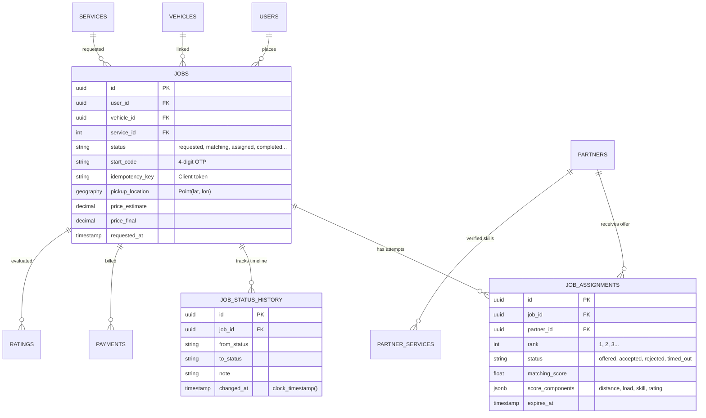

# 🎓 Sahayak (सहायक) — Final Viva Master Preparation Guide
> **Comprehensive Project Analysis, System Design, Backend Architecture, Concurrency, DSA & Viva Q&A**  
> *Targeted for Polaris School of Technology — Final OJT Sem-3 Viva (Mentor: Subham Das)*  
> *Language: Clear English + Hinglish Explanations (Easy to explain in interview)*

---

## 📑 Quick Index (Table of Contents)
1. [Project Overview & 60-Second Elevator Pitch](#1-project-overview--60-second-elevator-pitch)
2. [Tech Stack Breakdown — Konsa Tool Kaha & Kyu Use Kiya?](#2-tech-stack-breakdown--konsa-tool-kaha--kyu-use-kiya)
3. [Deep Dive: The Dispatch Engine (Heart of the Project)](#3-deep-dive-the-dispatch-engine-heart-of-the-project)
   - 4-Stage Lifecycle (`find` -> `score` -> `dispatch` -> `respond`)
   - Redis GEO Commands & Working Internals (`GEOSEARCH`, `ZSET`, Geohash)
   - Multi-Criteria Scoring Formula & Bayesian Smoothing
   - Sequential Offer vs Broadcast Dispatch (60s TTL & Worker)
   - Search Radius Escalation (10km -> 20km -> 35km)
4. [Backend Architecture & Core Functions](#4-backend-architecture--core-functions)
   - Core API Routes & Services
   - Database Schema & Relational Design
   - Start Code (OTP) & Contact Masking Privacy
5. [System Design & Concurrency Deep-Dive](#5-system-design--concurrency-deep-dive)
   - Race Conditions Solved (`SELECT FOR UPDATE` & Strict Lock Order)
   - Capacity Model & Connection-Seconds Bottleneck (Supavisor 15 Pool)
6. [Failure Modes & Edge Cases (Kya Hoga Agar...)](#6-failure-modes--edge-cases-kya-hoga-agar)
   - Payment Failures & Fraud Prevention
   - Network Drops & Idempotency Keys (`X-Idempotency-Key`)
   - Redis Crash & Graceful Degradation (ADR-016)
   - Partner No-Show / Timeout
7. [DSA & Mathematical Approaches (Mentor Impressive Points)](#7-dsa--mathematical-approaches-mentor-impressive-points)
8. [Future Roadmap & 100x Scale System Design](#8-future-roadmap--100x-scale-system-design)
9. [Top 25 Rapid-Fire Viva Questions & Answers](#9-top-25-rapid-fire-viva-questions--answers)

---

## 1. Project Overview & 60-Second Elevator Pitch

### 🎙️ How to introduce your project to the Mentor (60s Pitch in Hinglish/English):
> *"Good morning Sir. My project is **Sahayak** — a real-time emergency roadside assistance and dispatch platform designed for rapid vehicle breakdown recovery.*
> 
> *Traditional solutions like Google Maps only show static garage pins, jahan yeh pata nahi hota ki mechanic currently available hai ya nahi, unke paas specific tools ya towing capacity hai ya nahi, aur actual ETA kitna hoga.*
> 
> *Sahayak solves this through a **two-tier low-latency dispatch engine**:*
> *1. Hum **Redis GEO** use karte hain sub-millisecond proximity filtering ke liye.*
> *2. Phir **PostgreSQL/PostGIS** se verified partner capabilities, active workload aur equipment validate karte hain.*
> *3. Humne ek **multi-criteria weighted scoring algorithm** banaya hai jo Distance, Active Workload, Skill match aur **Bayesian-smoothed rating** ko combine karke best candidate select karta hai.*
> *4. Concurrency manage karne ke liye humne strict **PostgreSQL row-level locking (`SELECT FOR UPDATE`)** aur ek automated **background dispatch worker** implement kiya hai jo race conditions aur expired offers ko autonomously handle karta hai."*

---

## 2. Tech Stack Breakdown — Konsa Tool Kaha & Kyu Use Kiya?

| Layer / Technology | Kaha Use Hua? (Where?) | Kyu Use Kiya? (Why chosen over alternatives?) |
|---|---|---|
| **FastAPI (Python 3.11+)** | Core Backend API Service | Asynchronous performance (ASGI / AsyncIO), native Pydantic data validation, automatic OpenAPI/Swagger documentation, fast execution compared to Django/Flask. (ADR-001) |
| **PostgreSQL 15+ + PostGIS** | Durable Relational & Geospatial Storage | ACID transactions, strict schema constraints, foreign keys, row-level locking (`SELECT ... FOR UPDATE`), and PostGIS spatial indexing (`ST_DWithin`, geography coordinates). (ADR-002) |
| **Redis 7+ (GEO Sets & Hashes)** | In-Memory Ephemeral Geospatial Store | Live partner GPS coordinates update every 15-60s. RDBMS mein baar-baar live location write karne se disk I/O channelling aur table bloat hota hai. Redis in-memory `GEOSEARCH` executes in < 2ms without touching disk! (ADR-002) |
| **Supabase Auth / JWT** | Authentication & RBAC | Secure passwordless/phone/email auth with JWT tokens. Role-Based Access Control (`user/owner`, `partner`, `admin`). |
| **React + TypeScript (Vite)** | Web Dashboard (Owner, Partner, Admin) | Type-safe single-page application, fast rendering, React Query for server state management & polling. |
| **Expo React Native** | Mobile App (Owner & Partner) | Cross-platform mobile UX, hardware GPS access, native push notifications via Expo Push Service. |
| **MapLibre GL + OpenFreeMap** | Map Rendering in Mobile/Web | Cost-effective vector map rendering without running into expensive Google Maps API billing quotas. (ADR-031) |
| **Docker & Docker Compose** | Containerization & Local Dev | Reproducible local & staging environments (Postgres + PostGIS, Redis, FastAPI). (ADR-006) |

---

## 3. Deep Dive: The Dispatch Engine (Heart of the Project)

Dispatch engine pure project ka core backend intelligence hai. Yeh decide karta hai ki kaunsa mechanic/partner user ki breakdown request receive karega.

```
[Owner Requests Help] 
       │
       ▼
1. find_candidates() ───► Redis GEOSEARCH (Radius Filter: 10km) ──► Postgres SQL (Skill/Equip Filter)
       │
       ▼
2. score_candidates() ──► Weighted Ranking (Distance + Load + Skill + Bayesian Rating)
       │
       ▼
3. dispatch_job() ─────► Offer sent to Rank #1 Partner (Status: matching, 60s TTL)
       │
       ├─────────────────────────────────┬─────────────────────────────────┐
       ▼ [Accepted]                      ▼ [Rejected]                      ▼ [Timed Out (60s)]
  Job -> assigned                   _offer_next() (Rank #2)           Worker times out offer (ADR-032)
  Contact details unmasked          If candidates exhausted:          Automatically offers Rank #2
  Start Code active                 Job -> no_match_found             Radius widens: 10km -> 20km -> 35km
```

### A. The 4-Stage Lifecycle

1. `find_candidates(db, job, exclude_partner_ids, radius_m)`:
   - **Stage 1 (Redis GEO):** Pickup point ke around radius (default 10 km) mein active partners dhundta hai using `GEOSEARCH`. Yeh sirf ~5-20 IDs return karta hai in < 2ms.
   - **Stage 2 (Postgres SQL):** In 5-20 IDs ke upar relational validation run hoti hai:
     - Kya partner **verified** hai?
     - Kya partner **on-duty / available** hai?
     - Kya partner ke paas required **service & equipment** linked hai (e.g., puncture repair kit vs flatbed tow truck)?
     - Active load filter: partner currently $\le 1$ active job pe hona chahiye (`MAX_CONCURRENT_JOBS = 1`).
   - *Why Redis first and then Postgres?*
     > **Viva Answer:** Agar hum pehle SQL mein filter karte, toh database ko pure city/state ke hazaaron partners scan karne padte, phir unka distance calculate karna padta. Redis in-memory spatial index se 10km ke active partners mil jaate hain instant, phir SQL sirf un 10-15 IDs ko `WHERE id IN (...)` indexed query se validate karta hai!

2. `score_candidates(candidates)`:
   - Eligible candidates ko rank karta hai using a multi-criteria scoring function. Har component $[0, 1]$ mein normalize hota hai.

3. `dispatch_job(db, job)`:
   - Job ko `requested` se `matching` status mein transition karta hai.
   - Top-ranked candidate (Rank #1) ke liye `job_assignments` table mein offer record insert karta hai (`status = 'offered'`).
   - Offer par `expires_at = now() + 60s` timestamp lagta hai.
   - In-app aur Push notification trigger hoti hai partner ke phone par.

4. `respond_to_assignment(db, assignment_id, partner_id, response)`:
   - Partner Accept ya Reject karta hai.
   - **Accept:** Row lock liya jaata hai, capacity check hoti hai, job `assigned` ban jaata hai, aur owner ka phone number partner ko unlock ho jaata hai.
   - **Reject:** Assignment `rejected` mark hota hai, aur system automatically next best candidate (`_offer_next()`) ko offer bhejta hai.

---

### B. Redis GEO Commands & Working Internals

#### 1. Locations Store Kaise Hote Hain?
Jab partner ka mobile location update bhejta hai:
```python
# Redis GEOADD syntax: GEOADD key longitude latitude member
await redis_client.geoadd("sahayak:partner_locations", (longitude, latitude, partner_id))

# Also record timestamp in a string key to observe freshness:
await redis_client.set(f"partner:{partner_id}:location_updated_at", current_epoch_seconds)
```

#### 2. Radius Search Kaise Kaam Karta Hai?
```python
# Redis GEOSEARCH syntax:
candidates = await redis_client.geosearch(
    name="sahayak:partner_locations",
    longitude=pickup_lon,
    latitude=pickup_lat,
    radius=radius_m,
    unit="m",
    withdist=True,
    sort="ASC"
)
```
- `withdist=True`: Redis exact distance (in meters) bhi return karta hai, jisse hum scoring formula mein use karte hain.
- `sort="ASC"`: Nearest partner pehle sort hota hai.

#### 3. Redis GEO Internals (Under the Hood — DSA Concept!):
> **Mentor Question:** *"Redis coordinates kaise store karta hai? Under the hood kaunsa data structure hai?"*  
> **Your Answer:**  
> *"Sir, Redis GEO alag se koi naya data type nahi hai — yeh internally **Sorted Set (`ZSET`)** par built hai!*  
> *Jab hum `GEOADD` run karte hain, toh Redis Latitude aur Longitude ko **52-bit Geohash integer** mein encode karta hai using a **Peano space-filling curve (Z-order curve)**.*  
> *Yeh 52-bit integer ZSET ka **score** ban jaata hai, aur partner ID **member** ban jaati hai.*  
> *Radius search (`GEOSEARCH`) karte waqt Redis 2D geographical area ko 1D integer ranges mein convert karke Sorted Set ke upar binary search (Skip List search) run karta hai in $O(N + \log M)$ time complexity!"*

---

### C. Multi-Criteria Scoring Formula & Bayesian Smoothing

Every candidate gets a composite score between $0.0$ and $1.0$:

$$\text{Final Score} = (0.4 \times S_{\text{distance}}) + (0.2 \times S_{\text{load}}) + (0.2 \times S_{\text{skill}}) + (0.2 \times S_{\text{rating}})$$

Where weights sum to $1.0$:
- **Distance Weight ($0.4$):** Stranded customer highway pe khada hai, ETA is the most critical factor!
  $$S_{\text{distance}} = \max\left(0.0, 1.0 - \frac{\text{distance\_m}}{\text{max\_radius\_m}}\right)$$
  *(Linear decay: 0m par 1.0 score, 10km edge par 0.0 score).*
- **Load Weight ($0.2$):** Soft penalty for concurrent work.
  $$S_{\text{load}} = \frac{1.0}{1.0 + \text{active\_job\_count}}$$
  *(0 active jobs $\rightarrow$ 1.0, 1 active job $\rightarrow$ 0.5).*
- **Skill Weight ($0.2$):** Currently 1.0 for exact verified service match.
- **Rating Weight ($0.2$):** Bayesian-Smoothed Rating.

#### 🌟 Bayesian Smoothing for Ratings (Very High Impressive Value!):
> **Mentor Question:** *"Tumne direct average rating (`rating_avg / 5.0`) kyu nahi use ki?"*  
> **Your Answer:**  
> *"Sir, raw average use karne se **Cold Start Problem** aur **Small Sample Variance** create hoti hai:*  
> *Agar koi naya mechanic 1 job complete karke single 5-star rating le leta hai, toh uska raw average 5.0 ho jayega. Wo saal bhar se 100 jobs complete karne wale 4.8 rated reliable mechanic ko beat kar dega!*  
> *Aur agar kisi naye partner ka pehla customer 1-star de de, toh wo 1.0 average par freeze ho jayega aur use kabhi agli job offer hi nahi hogi!*  
>  
> *Isliye humne **Empirical Bayesian Smoothing (Dirichlet-Normal prior)** use kiya:*

$$\text{Smoothed Rating} = \frac{(R \times v) + (m \times C)}{v + C}$$

Where:
- $R$ = Partner's observed raw average rating.
- $v$ = Number of reviews partner has received (`rating_count`).
- $m$ = **Prior Mean = 3.5** (unremarkable but fine assumption for verified partners).
- $C$ = **Prior Weight = 5.0** (equivalent to 5 pseudo-reviews).

**Result:**
- Unrated partner (0 reviews) $\rightarrow$ directly gets $3.5 / 5.0 = 0.70$ score (fair chance to get jobs).
- 1 review of 5★ $\rightarrow$ score becomes $\frac{(5 \times 1) + (3.5 \times 5)}{1 + 5} = \frac{22.5}{6} = 3.75$ (does not unrealistically jump to 5.0).
- 50 reviews of 4.8★ $\rightarrow$ score converges to $4.68$ (proven excellence wins!).

---

### D. Sequential Offer vs Broadcast Dispatch (Why 1-by-1?)

| Dispatch Strategy | How it works | Why Sahayak uses Sequential (Not Broadcast)? |
|---|---|---|
| **Broadcast (Uber/Ola pool style)** | Blast notification to all 20 nearby mechanics at once. "First to tap gets it". | **Unsuitable for breakdown assistance:** Mechanics are driving, repairing under a hood, or handling greasy tools. Broadcast causes dangerous "fastest-finger-first" panic, high cancellation rate, and frustration among mechanics who tapped 0.1s late. |
| **Sequential Dispatch (Sahayak)** | Top-ranked mechanic gets an exclusive offer for **60 seconds** (`OFFER_TTL_S = 60`). | High quality, predictable ETA, no false promises to the customer. If unanswered in 60s, pass to Rank #2. |

#### The Background Dispatch Worker (`dispatch_worker.py` - ADR-032):
Pehle unanswered offer hamesha ke liye atak jaata tha agar mechanic phone na dekhe. 
Humne ek autonomous background worker banaya jo har **15 seconds** mein sweep run karta hai:
1. **Offer Timeout Sweep:** Jo offers 60s se zyada purane hain aur abhi bhi `offered` status mein hain, unhe `timed_out` mark karta hai aur automatic Rank #2 candidate ko offer release karta hai.
2. **Search Escalation Sweep:** Agar koi job `no_match_found` ho gayi thi, worker use 10-minute window ke andar wider radius par re-search karta hai.

---

### E. Search Radius Escalation (Tiered Widening - ADR-023)

Agar 10 km mein koi partner nahi mila, customer ko turant reject nahi kiya jaata:
- **0 to 2 minutes:** 10,000 m (10 km) — Normal city radius.
- **2 to 5 minutes:** 20,000 m (20 km) — Mechanics slightly further out.
- **5 to 10 minutes:** 35,000 m (35 km) — Highway recovery flatbeds and mobile service vans.
- **> 10 minutes:** Search window closes (`SEARCH_WINDOW_S = 600`), job marked permanently unserviceable.

---

## 4. Backend Architecture & Core Functions

### A. Main Backend Functions & Responsibilities

| File & Function | Role & What it does |
|---|---|
| `app/api/jobs.py` $\rightarrow$ `create_job` | Owner initiates request; validates pickup coordinate, snapshots vehicle & service base price, enforces `X-Idempotency-Key`, generates 4-digit `start_code`. |
| `app/services/dispatch_service.py` $\rightarrow$ `dispatch_job` | Main dispatch entrypoint; queries Redis GEO, applies DB filters, calculates weighted scores, commits assignment attempt rank #1. |
| `app/services/dispatch_service.py` $\rightarrow$ `respond_to_assignment` | Handles Partner Accept / Reject; takes row locks (`SELECT FOR UPDATE`), updates job & assignment state, triggers customer notification. |
| `app/services/dispatch_worker.py` $\rightarrow$ `sweep_once` | Periodic background task (every 15s) expiring 60s stale offers and widening radius for unmatched jobs. |
| `app/services/payment_service.py` $\rightarrow$ `confirm_payment` | Settlement handler; guarantees ONLY the receiving partner or admin can mark payment `paid` (owner cannot self-confirm). |
| `app/api/partners.py` $\rightarrow$ `update_partner_location` | Partner updates GPS coords; writes directly to Redis GEO set `sahayak:partner_locations`. |
| `app/services/rating_service.py` $\rightarrow$ `submit_rating` | Records 1-5 star review, updates running count & average, recomputes Bayesian rating score. |

---

### B. Core Database Schema & Entities



#### Key Architecture Principles in our Schema:
1. **Derived Data is Never Stored:** Partner ka `active_job_count` database table mein column bana kar nahi rakha gaya — use hamesha runtime pe active jobs count karke derive kiya jaata hai. Isse drift ya de-sync hone ka zero chance hota hai!
2. **Append-Only Status History:** Har status transition ke sath `job_status_history` table mein row insert hoti hai with `clock_timestamp()`. Audit aur SLA tracking ke liye immutable record rehta hai.
3. **4-Digit Start Code (OTP):** Jab partner physically breakdown spot par pahunchta hai, customer use 4-digit code verbally batata hai (`POST /jobs/{id}/start`). Mechanic enters this code. Yeh prove karta hai ki mechanic sahi gadi ke saamne khada hai, proxy completion impossible hai!
4. **Customer Phone Masking (ADR-017):** Jab tak partner offer **Accept** nahi karta, use customer ka mobile number display nahi hota (only approximate pickup distance & issue description). Customer privacy protect rehti hai.

---

## 5. System Design & Concurrency Deep-Dive

### A. Race Conditions Solved (The "Concurrency Bug Hunt")

Concurrency roadside assistance platform mein sabse dangerous problem hoti hai. Yaha 4 critical race conditions hain jo humne code mein solve ki hain:

#### Race Condition 1: Accept vs Worker Timeout Race
- **Scenario:** Partner A ko offer mila. 59.9th second par partner ne "Accept" dabaya. Usi millisecond background worker ne sweep run karke offer ko "Timed Out" mark karne ki koshish ki.
- **Catastrophe if unhandled:** Partner A ko lagega job uski ho gayi, par worker ne job Partner B ko offer kar di $\rightarrow$ Double Assignment!
- **Our Fix (ADR-015 & ADR-032):**
  ```python
  # In respond_to_assignment:
  job = await job_repository.get_job_by_id_for_update(db, job_id) # SELECT FOR UPDATE
  # Re-read offer state UNDER THE SAME ROW LOCK:
  assignment = await job_repository.get_assignment_by_id(db, assignment_id)
  if assignment.status != "offered":
      raise ConflictError(ErrorCode.ASSIGNMENT_ALREADY_ANSWERED, "Offer expired or already answered")
  ```
  Worker aur Partner dono same row lock par queue hote hain. Jo pehle lock leta hai wo commit karega, dusra cleanly 409 Conflict dega!

#### Race Condition 2: Ek Partner do alag jobs ek sath accept kar le (Capacity Race)
- **Scenario:** Partner ke paas do offers the (ya do devices se tap kiya). Dono requests alag-alag job IDs ki hain, toh `Job` row lock dono ko isolate nahi kar sakta!
- **Our Fix:** Humne **Strict Two-Phase Lock Ordering** implement kiya:
  1. Lock `Job` row (`SELECT FOR UPDATE`).
  2. Lock `Partner` row (`SELECT FOR UPDATE WHERE id = :partner_id`).
  3. Validate: `active_job_count < MAX_CONCURRENT_JOBS`.
  4. Update `Job` $\rightarrow$ `assigned`.
  *Lock order hamesha Job $\rightarrow$ Partner $\rightarrow$ Assignment hota hai, jisse deadlock probability mathematically 0% ho jaati hai!*

#### Race Condition 3: Customer Cancels while Partner is Accepting
- Customer `cancel_job` dabata hai jab partner `accept` daba raha hai.
- Dono endpoints `job_repository.get_job_by_id_for_update()` call karte hain.
- Agar Cancel pehle acquire karta hai: Job status `cancelled` ho jaati hai. Jab partner ki thread lock acquire karegi, wo check karegi `if job.status != 'matching': raise ConflictError`. Partner ko cleanly error milega "Job was cancelled by owner".

---

### B. Capacity Model & Connection-Seconds Bottleneck

Humne production load profiling ki with `pg_stat_statements` aur Locust/k6 concurrency tests:
- **Supavisor Shared Connection Ceiling:** 15 pooled connections.
- **Measured Job Creation Hold Time:** **1198 ms** (~32 database round-trips, including ORM transaction lifecycle).
- **Network RTT (Application $\leftrightarrow$ Postgres Pooler):** 30–47 ms.

#### The Real Capacity Bottleneck (Crucial Viva Point!):
> **Mentor Question:** *"System design capacity model mein bottleneck kahan tha? Job creation ya polling?"*  
> **Your Answer:**  
> *"Sir, initial assumption thi ki job creation bottleneck hogi. Lekin mathematical capacity model aur profiling ne prove kiya ki **Job creation connection budget ka sirf < 1% spend karti hai!**  
> Asli bottleneck **Idle Partners ki Short Polling** thi!  
> 300 online mechanics har 15s mein offers poll kar rahe the aur 30s mein notifications. Har polled read 3 DB round trips (BEGIN, SELECT, ROLLBACK) leti hai.  
> Polling connection-seconds budget ko rapidly exhaust kar rahi thi.  
> Isliye hamari top roadmap priority polling ko **Redis Pub/Sub based Server-Sent Events (SSE)** se replace karna hai!"*

---

## 6. Failure Modes & Edge Cases (Kya Hoga Agar...)

### A. Payment Failures & Security

1. **Agar Payment Gateway / UPI fail ho jaye toh kya hoga?**
   - Payment record table mein insert hota hai with `status = 'pending'`.
   - Agar UPI intent fail hota hai ya cancel hota hai, record `status = 'failed'` mark hota hai.
   - Endpoint `POST /payments` idempotent hai: agar payment fail ho gayi, user bina naya job create kiye payment retry kar sakta hai ya alternative method (e.g. Cash on Delivery) choose kar sakta hai.
   - Job complete tabhi mark ho sakti hai jab payment status `paid` ho.

2. **Customer Fraud Prevention (ADR-022):**
   - *Can customer mark payment as 'paid'?* **ABSOLUTELY NO!**
   - Payment confirmation endpoint (`POST /payments/{id}/confirm`) par strict role check hai: **Sirf assigned partner ya platform admin hi payment confirm kar sakta hai.**
   - Payer (customer) kabhi khud prove nahi kar sakta ki usne paise de diye — receiver (mechanic) jab cash ya bank credit verify karega, tabhi status `paid` hoga.

3. **Price Manipulation Guard:**
   - Amount payload mein client se accept nahi kiya jaata. Amount direct database mein stored `job.price_final` ya `job.price_estimate` se calculate hota hai. Koi user Rs 899 ki job ko Rs 1 payload bhej kar exploit nahi kar sakta!

---

### B. Request Failures & Idempotency (`X-Idempotency-Key`)

1. **Agar network drop ho jaye breakdown request bhejte waqt?**
   - Mobile app har request ke sath client-generated UUID `idempotency_key` bhejti hai.
   - Database table `jobs` par Unique Constraint hai: `(user_id, idempotency_key)`.
   - Agar mobile network jitter ki wajah se duplicate request dobara hit karti hai, database duplicate row create karne ke bajaye existing job return kar deta hai (`200 OK`). Duplicate charge ya duplicate mechanic dispatch hona impossible hai!

2. **Agar API server crash ho jaye job create hone aur dispatch hone ke beech?**
   - Job database mein durable ho chuki hai with status `requested`.
   - Dispatch worker job status history monitor karta hai aur crash recovery sweep run kar sakta hai.

---

### C. Redis Outage / Crash (Graceful Degradation - ADR-016)

> **Mentor Question:** *"Agar live production mein Redis crash ho jaye, toh kya pura platform down ho jayega?"*  
> **Your Answer:**  
> *"No Sir! Humne **Graceful Degradation** implement kiya hai:*  
> *1. Redis crash hote hi `dispatch_service` `DispatchUnavailableError` catch karta hai.*  
> *2. Relational PostgreSQL crash nahi hota — customer ki job save rehti hai.*  
> *3. Job status timeline mein explicit note likha jaata hai: `DISPATCH_UNAVAILABLE_NOTE = "Dispatch unavailable: could not reach the partner location service"`.*  
> *4. Admin dashboard alerts trigger hote hain, aur operations team manual fallback dispatch console se phone call karke mechanic assign kar sakti hai.*  
> *5. Future mitigation mein humne PostGIS `ST_DWithin` fallback query design ki hai jo Redis down hone par database ke last known coordinates se nearest mechanic pick kar sakti hai!"*

---

## 7. DSA & Mathematical Approaches (Mentor Impressive Points)

Mentor ko yeh algorithms explain karke dikhana:

### 1. Spatial Inverted Indexing & Geohashing (Redis GEO)
- 2D geographical coordinates $(x, y)$ ko 1D Z-order curve mein map kiya using 52-bit integer binary interleaving.
- Search time complexity: $O(N + \log M)$, where $M$ is total fleet in Redis and $N$ is returned candidate count in radius.

### 2. Haversine Great-Circle Distance
- Spherical trigonometry formula to calculate exact surface distance between two latitude/longitude points accounting for Earth's curvature:
  $$d = 2r \arcsin\left(\sqrt{\sin^2\left(\frac{\Delta \phi}{2}\right) + \cos(\phi_1)\cos(\phi_2)\sin^2\left(\frac{\Delta \lambda}{2}\right)}\right)$$

### 3. Empirical Bayesian Estimation (Conjugate Dirichlet Prior)
- Rating distribution smoothing to prevent cold-start distortion:
  $$\hat{\theta} = \frac{\sum x_i + m \cdot C}{n + C}$$

### 4. Deterministic Finite Automaton (Finite State Machine - FSM)
- Job Lifecycle transitions strictly regulated via Directed Acyclic State Machine with terminal checks:
  `requested` $\rightarrow$ `matching` $\rightarrow$ `assigned` $\rightarrow$ `partner_en_route` $\rightarrow$ `in_progress` $\rightarrow$ `completed`.
  *(Transitions to `cancelled` or `no_match_found` are validated so invalid jumps like `cancelled` $\rightarrow$ `completed` raise `409 Conflict`).*

### 5. Two-Phase Locking (2PL) & Resource Hierarchy Tree
- Deadlock-free concurrency control using strict partial ordering of lock acquisition:
  $$\text{Lock}(\text{Job}) \prec \text{Lock}(\text{Partner}) \prec \text{Lock}(\text{Assignment})$$

### 6. Sliding Window Counter / Token Bucket
- API rate limiting utility in `app/utils/rate_limit.py` to protect auth and dispatch endpoints against DDoS and brute force.

### 7. Greedy Sequential Matching vs Hungarian Bipartite Matching
- Why sequential greedy with rollback was preferred over Kuhn-Munkres (Hungarian) batch matching: Emergency roadside assistance requires low latency ($<2$ seconds first offer). Batch matching requires buffering requests for 30-60 seconds, which increases driver breakdown anxiety.

---

## 8. Future Roadmap & 100x Scale System Design

Agar mentor puche: *"Kal ko tumhare paas 10 Lakh (1 Million) active users aur 50,000 mechanics aa gaye, toh architecture kaise scale karoge?"*

```
               [Clients: Web & Mobile Apps]
                           │
                           ▼ HTTPS / WSS
              [Cloudflare CDN + Anycast DNS]
                           │
                           ▼
          [API Gateway / NGINX Load Balancer]
             (Rate Limiting & SSL Termination)
                           │
       ┌───────────────────┴───────────────────┐
       ▼                                       ▼
[FastAPI App Instances]            [FastAPI App Instances]
(Stateless Web/API Tier)            (Stateless Web/API Tier)
       │                                       │
       ├─── Redis Pub/Sub (SSE / WebSockets) ◄─┘
       │    (Real-time live driver tracking & offers)
       │
       ├─── Redis Cluster (GEO Sharded by City/H3 Hexagons)
       │    (Bangalore, Delhi, Mumbai sharded keys)
       │
       ├─── Kafka / Celery Async Task Queue
       │    (Transactional outbox for push notifications, SMS & analytics)
       │
       ▼
[PostgreSQL Primary (Writes)] ── (Logical Replication) ──► [Read Replicas]
 (PgBouncer Connection Pooling)                              (Admin Analytics & Reports)
```

### Key Scaling Strategies to Mention:
1. **Kill Short Polling with Server-Sent Events (SSE) / WebSockets:**
   - Current polling creates connection exhaustion on Supavisor.
   - Solution: Client keeps 1 persistent WebSocket or SSE stream connected to Redis Pub/Sub. Job update aate hi push event deliver hota hai — zero database reads during idle wait!
2. **Spatial Sharding with Uber's H3 Hexagonal Hierarchical Spatial Index:**
   - Instead of single `sahayak:partner_locations` key, partition Redis GEO by City or H3 Hexagon Resolution 7 (~1.2 km radius cells). Search only checks current hexagon and 6 adjacent neighbors.
3. **Database Read/Write Splitting & Connection Pooling (PgBouncer):**
   - Write queries go to Primary PostgreSQL instance.
   - Read queries (Admin analytics, history inspection, ratings read) go to Read Replicas.
   - PgBouncer in `transaction` mode increases concurrency from 15 connections to 10,000+ client connections!
4. **Transactional Outbox Pattern for Push & Notifications:**
   - API transaction ke andar `outbox` table mein message likhegi. Debezium / background worker use reliably read karke Kafka/RabbitMQ push karega. Zero dropped pushes even if push gateway restarts.

---

## 9. Top 25 Rapid-Fire Viva Questions & Answers

### Q1: What is the primary problem Sahayak solves?
**Ans:** Traditional maps only show static garage pins without real-time availability, capability verification, or guaranteed response times. Sahayak provides real-time, low-latency, capability-verified dispatch of mechanics with automated pricing and live tracking.

### Q2: Why did you choose Redis GEO instead of running PostGIS queries for everything?
**Ans:** Mechanics update their GPS every 15–30 seconds. Writing high-frequency ephemeral locations into PostgreSQL causes heavy WAL write overhead, disk I/O bottlenecks, and table bloat. Redis GEO works completely in-memory, updating and querying locations with `GEOSEARCH` in under 2 milliseconds. PostGIS is used for durable, completed job history and static boundary queries.

### Q3: What is the dispatch scoring formula?
**Ans:** $\text{Score} = 0.4 \times \text{Distance} + 0.2 \times \text{Workload} + 0.2 \times \text{Skill} + 0.2 \times \text{Rating}$. All normalized to $[0, 1]$. Distance has the highest weight (0.4) because in roadside emergency, ETA is the top priority for stranded drivers.

### Q4: Why did you use Bayesian Smoothing for ratings?
**Ans:** Raw average rating suffers from low-sample bias — a mechanic with one 5-star review would outrank a mechanic with fifty 4.8-star reviews. Using Empirical Bayes with prior mean $m=3.5$ and prior weight $C=5$, unrated mechanics start with a fair prior (3.5/5), and scores converge smoothly as real reviews accumulate.

### Q5: How do you prevent two mechanics from accepting the same job at the same time?
**Ans:** We use PostgreSQL row-level locking via `SELECT ... FOR UPDATE` inside `respond_to_assignment()`. When a mechanic attempts to accept, the job row is locked. The first transaction moves the job status to `assigned` and commits. The second transaction waiting on the lock reads the updated status, fails the state condition, and receives an HTTP 409 Conflict error.

### Q6: What happens if a mechanic accepts an offer at the exact millisecond the worker times it out?
**Ans:** Both `respond_to_assignment` and the worker's `expire_offer` acquire the job row lock via `get_job_by_id_for_update()`. Under the lock, the assignment status is re-read. If the worker timed it out first, the partner's accept sees status `timed_out` and receives HTTP 409 `ASSIGNMENT_ALREADY_ANSWERED`. If the partner accepted first, the worker sees status `assigned` and safely skips it.

### Q7: Why do you lock the Job first, then the Partner row?
**Ans:** Strict Lock Ordering avoids Deadlocks. If Transaction A locks Job then Partner, and Transaction B locks Partner then Job, a circular wait deadlock occurs. By enforcing `Job -> Partner -> JobAssignment` everywhere in the codebase, circular wait is mathematically impossible.

### Q8: What does the Background Dispatch Worker do?
**Ans:** It runs an asynchronous sweep every 15 seconds (`sweep_once`). It performs two jobs:
1. Times out unanswered offers older than 60 seconds and triggers re-offering to candidate Rank #2.
2. Escalates and widens search radius (10km $\rightarrow$ 20km $\rightarrow$ 35km) for jobs in `no_match_found` status within their 10-minute active window.

### Q9: Why is assignment sequential instead of broadcast?
**Ans:** Broadcast dispatch ("fastest finger first") creates high stress, dangerous driving distractions for mechanics, and high cancellation rates. Sequential dispatch gives the top-ranked qualified mechanic an exclusive 60-second window, ensuring reliable service.

### Q10: How do you verify that the mechanic is actually at the vehicle before starting work?
**Ans:** The system generates a server-side 4-digit `start_code` visible ONLY to the vehicle owner. When the mechanic arrives physically, the owner verbally shares this code. The mechanic submits it via `POST /jobs/{id}/start`. Without this OTP, the job cannot transition to `in_progress`.

### Q11: How do you protect customer privacy?
**Ans:** Contact details (phone number) are masked (ADR-017). An offered mechanic only sees the pickup coordinate, vehicle type, and issue description. The customer's real phone number is released to the partner only AFTER the partner accepts the assignment.

### Q12: Why can't a customer mark a payment as 'paid'?
**Ans:** Allowing payers to self-confirm settlement creates obvious fraud vulnerabilities. Per ADR-022, only the receiving party (assigned partner who collected cash/verified UPI) or a platform admin can invoke `confirm_payment`.

### Q13: What happens if payment fails?
**Ans:** The payment row status transitions to `failed`. Because the payment initiation endpoint is idempotent and handles failed states, the client can re-initiate payment or switch between UPI intent and Cash on Delivery without creating duplicate jobs or losing job context.

### Q14: How do you handle network drops when an owner submits a job?
**Ans:** The client generates a unique `X-Idempotency-Key` (UUID). The database has a unique constraint on `(user_id, idempotency_key)`. If a dropped connection causes the client to retry, the server catches the duplicate key and returns the existing job without creating duplicates.

### Q15: What happens if Redis goes down?
**Ans:** The system degrades gracefully (ADR-016). Instead of crashing, `DispatchUnavailableError` is caught, the job is marked `no_match_found` with an audit note `"Dispatch unavailable: could not reach the partner location service"`, alerting admins to perform manual dispatch overrides.

### Q16: What was the main takeaway from your Capacity Profiling?
**Ans:** We discovered that job creation holds database connections for ~1.2s across ~32 round-trips, but spends less than 1% of the connection budget. The real capacity drain is Short Polling from hundreds of idle mechanics polling for new offers. Replacing short polling with Server-Sent Events (SSE) is our primary scalability fix.

### Q17: How are prices calculated? Can a user tamper with the price in the frontend?
**Ans:** Base prices are stored on the server in the `services` table. When a job is created, the server snapshots the estimate (`price_estimate`). Clients cannot specify the amount in the payment payload; `payment_service` reads the price strictly from the database row.

### Q18: What data structure does Redis use for GEO commands?
**Ans:** A **Sorted Set (`ZSET`)**. Coordinates are converted into a 52-bit integer Geohash using a space-filling Z-order curve. This integer is stored as the score in the ZSET. Radius queries execute range scans on this sorted index in $O(N + \log M)$ time.

### Q19: What is the Search Radius Escalation policy?
**Ans:** If no mechanic is available in the initial 10 km radius:
- 0–2 min: 10 km
- 2–5 min: 20 km
- 5–10 min: 35 km (highway recovery vans)
- After 10 min: Search window closes to avoid indefinite customer waiting.

### Q20: What is the baseline comparison model in your project?
**Ans:** To scientifically evaluate whether our multi-criteria weighted algorithm actually provides better results than naive matching, every assignment records `was_baseline_choice` (whether the chosen mechanic was the absolute closest partner). This allows analytics to prove that factors like rating, skill, and load prevent dispatching poorly-rated or overloaded mechanics who happen to be nearby.

### Q21: How do you handle partner verification?
**Ans:** Partners submit documents during registration. Their status is set to `pending`. Platform admins review equipment, driver's license, and garage credentials in the Admin Queue before flipping status to `verified`. Only verified partners appear in dispatch candidates.

### Q22: Why did you choose Docker Compose instead of Kubernetes?
**Ans:** Per ADR-006, during early stage development and pilot testing, Kubernetes adds unnecessary operational complexity, node overhead, and deployment latency. Docker Compose provides deterministic local and staging environments with near-zero configuration overhead.

### Q23: Why do you store `clock_timestamp()` instead of `now()` in `job_status_history`?
**Ans:** In PostgreSQL, `now()` returns the start time of the *transaction*, not the actual statement execution time. When multiple concurrent transactions queue behind a row lock, sorting by `now()` can cause timeline inversion (e.g. `cancelled` showing before `assigned`). `clock_timestamp()` records the true wall-clock time of the write.

### Q24: How does Sahayak support different vehicle types?
**Ans:** Jobs snapshot vehicle specifications (make, model, fuel type, two-wheeler vs four-wheeler vs heavy commercial). The dispatch filter matches this against `partner_services` and `partner_equipment` to ensure a two-wheeler mechanic isn't dispatched to a truck breakdown.

### Q25: If you had 2 more weeks, what is the single most impactful feature you would build?
**Ans:** I would implement **Server-Sent Events (SSE) over Redis Pub/Sub** for live tracking and offer alerts. This would completely eliminate idle short polling, reducing database connection load by over 65% and giving sub-second real-time responsiveness to users.

---

## 💡 Quick Tips for Viva Day:
1. **Be Confident & Honest:** Agar mentor code ka koi specific corner case puche, relate it directly to **Row Locking (`SELECT FOR UPDATE`)** or **Worker Sweep (ADR-032)**.
2. **Mention the Numbers:** Yaad rakho: **60s Offer TTL**, **10km/20km/35km search tiers**, **15s Worker Sweep**, **3.5 Prior Mean**, **0.4 Distance Weight**. Mentors love exact numbers!
3. **Show Architecture Thinking:** Emphasize that you designed the system for **real-world edge cases** (network drops, dead batteries, double taps, payment fraud) rather than just a simple happy path CRUD app.

**All the best for your Viva! You have built a production-grade, battle-tested system! 🚀**
